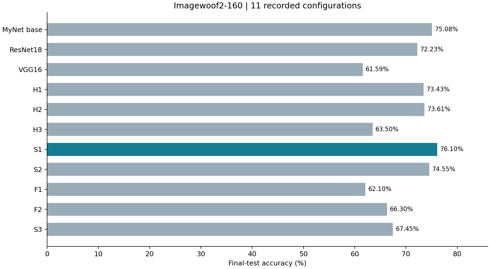

# PyTorch Image Classification Benchmark

A course project comparing a compact custom CNN (**MyNet**), ResNet18 and VGG16 on Imagewoof2-160. It emphasizes controlled experiments, validation-based model selection and auditable evaluation. All 11 recorded configurations were trained **from random initialization**; no pretrained weights were used.

**Selected model: 76.10% test accuracy, 74.89% macro F1, 1.50M parameters.** The selection was made using the internal validation set before final evaluation.



## What is implemented

- PyTorch training with CUDA AMP, gradient accumulation, checkpoint/resume and seeded data loading.
- A compact CNN with configurable stage widths, depth, activation and a global pooling head.
- Torchvision ResNet18/VGG16 with ten-class output heads.
- Stratified internal splits, separate augmentation/evaluation transforms, learning-rate scheduling and per-class metrics.
- Saved predictions, confusion matrices, training histories and a dependency-free result audit.

## Experiment design and results

The official `train/` directory contains 9,025 images: **7,220 internal training / 1,805 validation**, stratified with split seed 42. The official `val/` directory is treated as the **final 3,929-image test set**. It is not the internal validation set. S1 was selected by internal validation accuracy (75.96%).

| Configuration | Epochs | Test accuracy | Macro F1 |
| --- | ---: | ---: | ---: |
| MyNet baseline | 30 | 75.08% | 73.91% |
| ResNet18 | 30 | 72.23% | 71.27% |
| VGG16 | 30 | 61.59% | 61.12% |
| H1 / H2 / H3 | 30 | 73.43 / 73.61 / 63.50% | 72.23 / 72.77 / 62.34% |
| **S1 (selected)** | **30** | **76.10%** | **74.89%** |
| S2 | 30 | 74.55% | 73.64% |
| F1 (grayscale) | 20 | 62.10% | 61.24% |
| F2 (96 px input) | 20 | 66.30% | 65.84% |
| S3 (activation variant) | 20 | 67.45% | 66.62% |

S1 uses widths `[48,96,160,256]`, two convolutions per stage, a 96-channel head, ReLU, dropout 0.25, SGD (LR 0.01, momentum 0.9, weight decay 0.0005), cosine scheduling and batch size 16. See the per-run `config.json` files for exact H/S/F variants and [the full table](results/final_test/comparison.csv) for unrounded results.

F1/F2/S3 have shorter training budgets; their final-test scores alone do not isolate a causal effect of the changed feature or activation. This is a small, single-seed course benchmark, not a claim of state-of-the-art performance or general superiority over standard networks. VGG16 CUDA adaptive-pooling backward reports a nondeterminism warning under the recorded warn-only setting; training is not guaranteed to be bitwise identical across runs or platforms.

## Install and run

Recorded training environment: Python 3.11, PyTorch 2.9.1 + CUDA 12.6, torchvision 0.24.1, RTX 4050 Laptop GPU (6 GB). Use an isolated environment:

```bash
python -m venv .venv
# Activate .venv using your platform's activation command.
python -m pip install -r requirements.txt
python verify_results.py
```

`requirements.txt` pins the original CUDA build. For CPU-only use, install the matching CPU builds of `torch==2.9.1` and `torchvision==0.24.1` from the [official PyTorch index](https://download.pytorch.org/whl/cpu), plus the other pinned packages.

Obtain Imagewoof2-160 through the [fastai dataset project](https://github.com/fastai/imagenette#imagewoof), subject to its source terms. Extract it as `data/imagewoof2-160/{train,val}/<class>/*.JPEG`. Images and model weights are intentionally excluded.

```bash
# Imports, split/transform checks, all three networks' forward/backward passes,
# optimizer/scheduler checks, temporary checkpoint save/restore and plots:
python main.py --mode smoke --data-root data/imagewoof2-160 --device cuda

# Reproduce S1 using the archived configuration; writes under runs/:
python run_experiment.py --experiment S1 --data-root data/imagewoof2-160 --device cuda

# Other names: MyNet_Baseline, ResNet18, VGG16, H1, H2, H3, S2, F1, F2, S3.
# Use only after freezing model selection; evaluates the trained checkpoint:
python run_experiment.py --experiment S1 --data-root data/imagewoof2-160 --device cuda --final-test
```

Repeated training commands with the same run directory resume or reuse a completed run. Choose a new `--output-root` for an independent repeat. The final evaluation command saves accuracy, precision, recall and confusion matrix; archived macro F1 is independently recomputed by `verify_results.py`.

## Evidence and verification

`results/` contains archived histories, configurations, split indices and aggregate plots. `results/final_test/<name>/` contains labels/predictions and metrics for every run. The audit script recomputes accuracy, macro precision/recall/F1 from all **43,219 predictions** without downloading data or loading weights.

The publication review also reloads local original checkpoints and compares fresh inference with the archived predictions. Its actual outcome is recorded in [validation.json](validation.json); it is distinct from a fresh training reproduction. This repository does not ship checkpoints, so a reader must retrain to repeat inference.

The source course submissions remain unchanged. Publication edits make paths/output directories portable and add documentation, a configuration runner and result verification. Original absolute paths in JSON are redacted; embedded historical hashes still refer to original artifacts. [provenance.json](provenance.json) records original and curated file hashes. See [NOTICE.md](NOTICE.md) for attribution and publication scope.
